<div align="center">
  
  <h1>OnCue · 群聊试映室</h1>
  <p><b>在群里开口之前，先在这里试一下。</b></p>
  <p>
    
    
    
    
    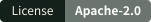
  </p>
  <p>
    <a href="https://www.bilibili.com/video/BV18aWA6HECb">演示视频（B 站）</a> ·
    <a href="#快速开始">快速开始</a> ·
    <a href="#工作原理">工作原理</a> ·
    <a href="oncue/VERIFICATION.md">验证记录</a> ·
    <a href="OnCue%20复赛PPT.pdf">复赛 PPT</a>
  </p>
  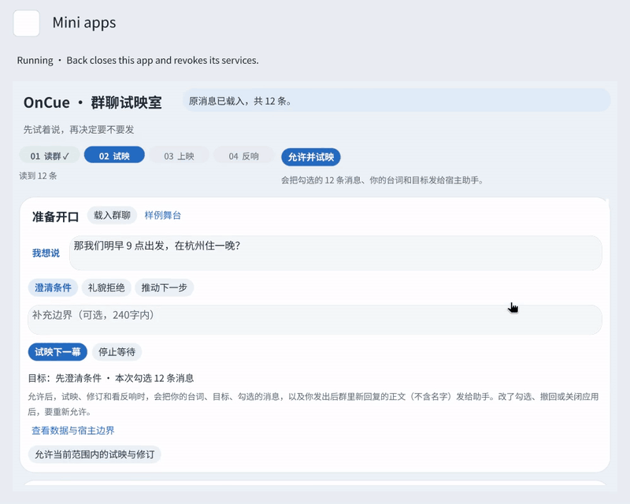
  <p><sub>官方 Rinx 1.3.0 真机录屏，等待部分已加速</sub></p>
</div>

OnCue 是运行在 OctoSense 的 Rinx 里的 Splash 小程序。它读你授权的群聊，请宿主助手写出三种说法，**由程序逐条核对事实**，最后**由你决定发不发**；发出去以后，再把群友的真实回复和试映时的预想对照，给出下一句。

## 功能

- **打开即读群**：打开就读所选的群，列出最近 12 条消息并保留原编号，可以勾选这次参考哪些。
- **三种说法，逐条核对**：按你选的目标（澄清条件、礼貌拒绝、推动下一步）写三种说法，并可标出一条推荐；程序核对每条的出处、数字和承诺句式，不合格的只拦那一条，并写明原因。
- **两步确认发送**：发送前再读一次群，有新消息先标出来；发出后读回核实，结果不确定时绝不自动重发。
- **看反响**：群友的回复按原话列出，助手对照试映时的预想给出下一句，这一步同样要过核对。
- **最小权限**：应用本身不联网、不持有密钥；8 项服务逐项授权，关闭应用或 1 小时后由宿主收回。
- **本地草稿**：草稿按群保存在本机，可以存 A、B 两版对照。

## 快速开始

**环境要求**

- [官方 Rinx 1.3.0 发布包](https://github.com/hagency-org/Rinx/releases/tag/v1.3.0)（验证所用版本）
- 一个已登录、有消息的 Matrix 群
- 在 Rinx 里配置好助手（模型）

没有选房间时，应用打开后进入本地样例，可以先看一遍流程，样例不调用模型。

**本地导入**

OnCue 已向 App Hub 提交上架审核（[#78](https://github.com/OctoSense-org/OctoSense-App-Hub/issues/78)），上架前用本地导入运行。

```bash
git clone https://github.com/codezzzsleep/OnCue.git
```

1. Rinx 里打开 **Discover → Mini apps → Import an app**。
2. 包路径填克隆下来的 `OnCue/bundle` 目录（未签名包，可以直接导入），房间填你的 Matrix 房间 ID。
3. 点 **Review bundle**，核对名称、版本、「Local unsigned bundle」标记、八项服务和 Allowed room，然后 **Run**。应用在独立的「Rinx · Mini apps」窗口里打开。

每次打开都要重新授权。完整步骤和常见问题见[运行说明](oncue/docs/RUNNING.md)。

## 使用

1. 写下想说的话，选一个目标，点「允许并试映」。
2. 看三种说法和推荐。推荐句通过核对后自动进草稿，可以直接改，也可以点「选用这句」换一条。
3. 点「发到群里」，核对发到哪个群、完整正文，再点「确认发送」。读回看到这条，才显示「已发到」。
4. 群里有人回复后点「看反响」，核对助手给的「下一句」，再「放进确认区」。

## 工作原理

<p align="center">
  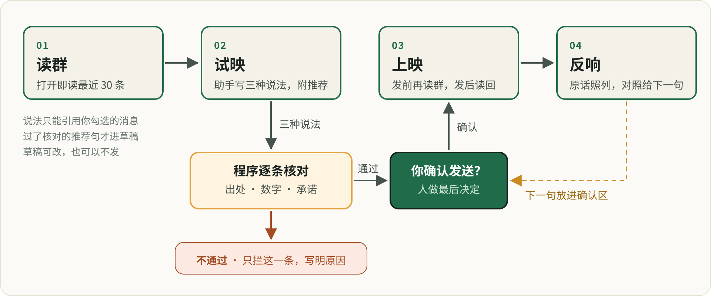
</p>

一句话：**助手写措辞，程序做核对，人来做决定。** 三道把关分别防三类问题：

| 问题 | 会发生什么 | OnCue 的把关 |
| --- | --- | --- |
| 编造 | 写出群里没人说过的数字和承诺 | 每条说法只能引用你勾选的消息；数字（含带单位的中文数字）、承诺句式没有出处就拒绝 |
| 越权 | 没确认就发；群里有了新消息还照发旧稿 | 两步确认才发送；发前再读群，有新消息先标出；发后读回，从不自动重发 |
| 断环 | 发完就结束，下一句只能靠猜 | 看反响：原话照列，对照预想给出下一句；对照同样要过检查 |

<details>
<summary><b>一次试映到发送的完整时序</b></summary>
<br>
<p align="center">
  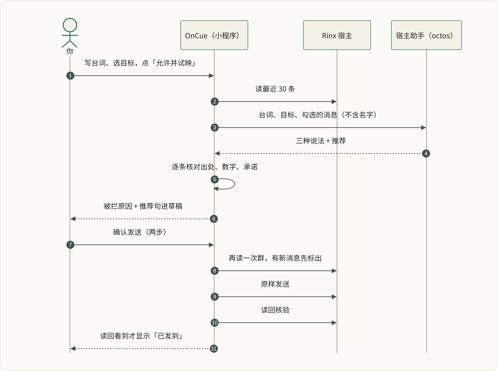
</p>
</details>

### 架构与权限

<p align="center">
  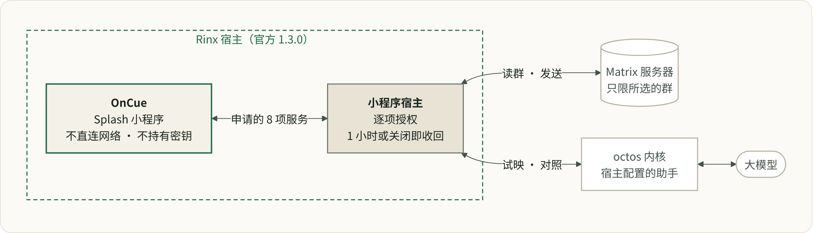
</p>

| 申请的服务 | 用途 |
| --- | --- |
| `storage` | 草稿按房间存在本机 |
| `matrix.room_info` | 房间名称与稳定身份 |
| `matrix.read_messages` | 读取所选群的最近消息，核对变化与发送结果 |
| `matrix.account_info` | 当前账号身份，用来确认「是我刚发的」 |
| `matrix.send_message` | 你确认后，把草稿原样发到这个群 |
| `octos.session.open` · `octos.turn.start` · `octos.turn.interrupt` | 请助手试映、修订、对照，以及停止等待 |

应用本身不联网；Rinx 和宿主助手可能联网并保留历史，在 OnCue 里删除草稿不影响那边。详见[数据说明](oncue/PRIVACY.md)。

## 截图

2026-10-13 在[官方 Rinx 1.3.0 发布包](https://github.com/hagency-org/Rinx/releases/tag/v1.3.0)（零本地补丁）上跑通完整闭环，模型 MiniMax-M2.7-highspeed。下面是那次运行的截图，完整记录见 [evidence/native-130](evidence/native-130/)。

<table>
  <tr>
    <td width="33%">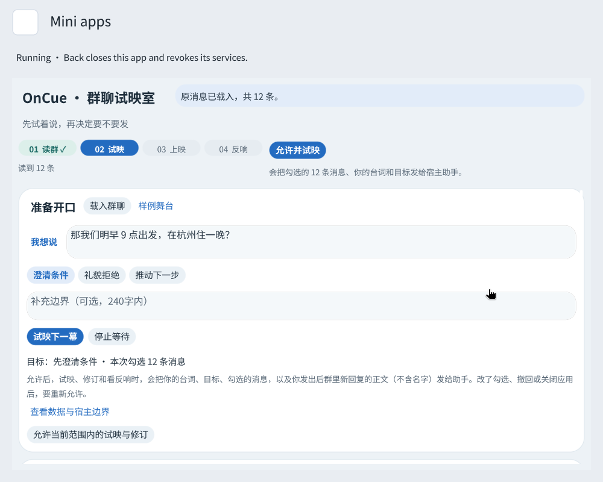</td>
    <td width="33%">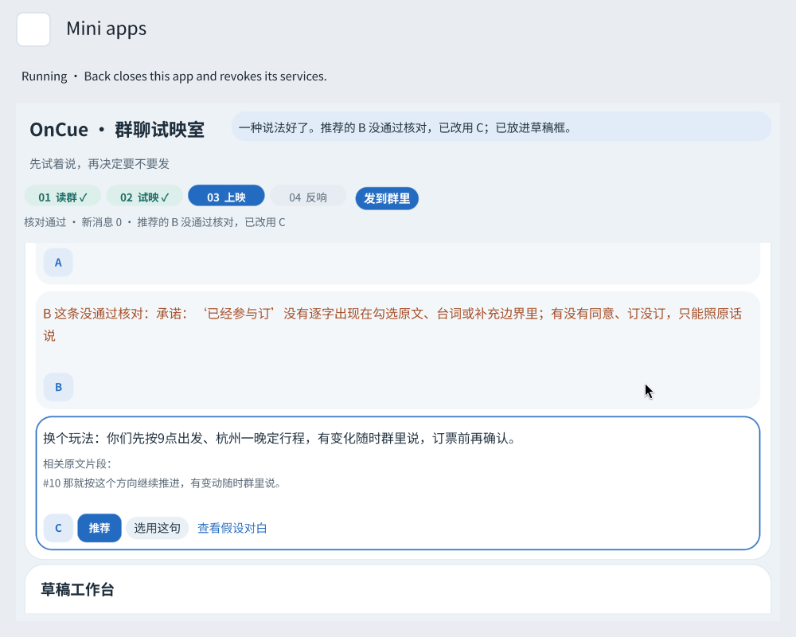</td>
    <td width="33%">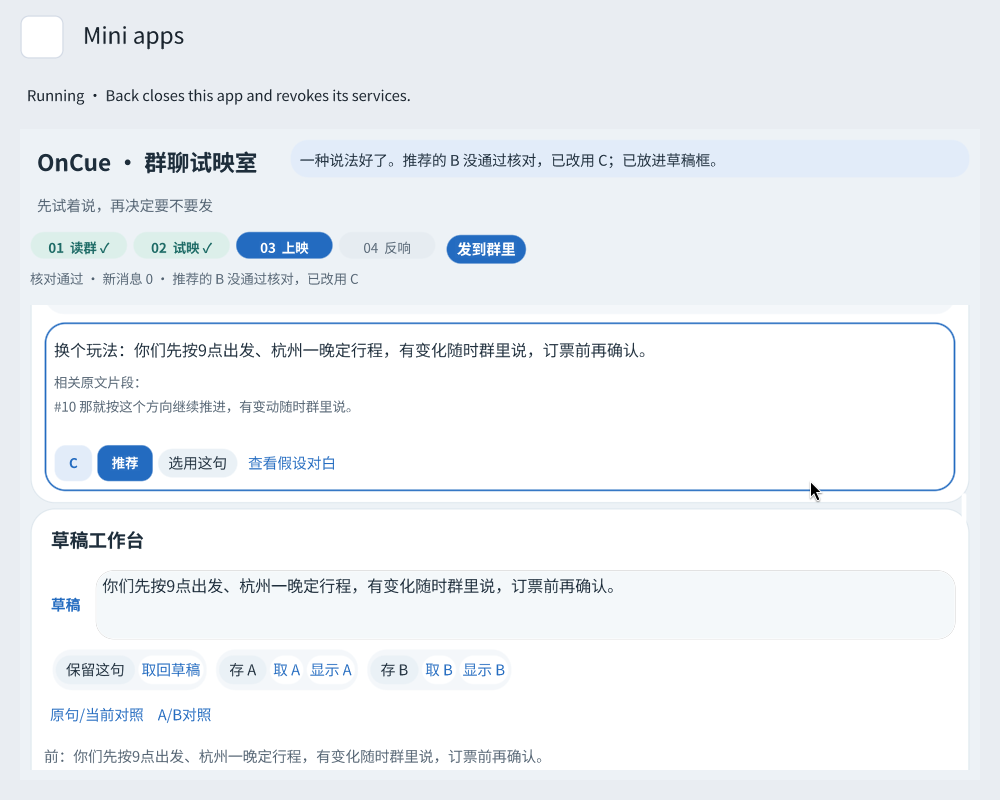</td>
  </tr>
  <tr>
    <td align="center"><sub>读群：打开就读，阶段条「读群」打勾</sub></td>
    <td align="center"><sub>核对：A、B 被拦并写明原因，推荐改用 C</sub></td>
    <td align="center"><sub>草稿：通过核对的推荐句进草稿框</sub></td>
  </tr>
  <tr>
    <td>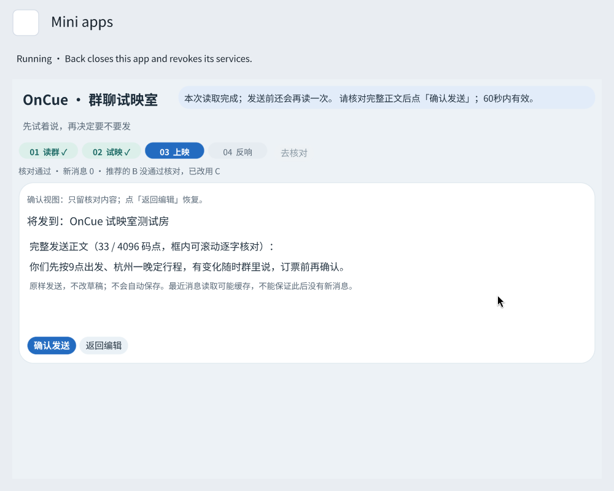</td>
    <td>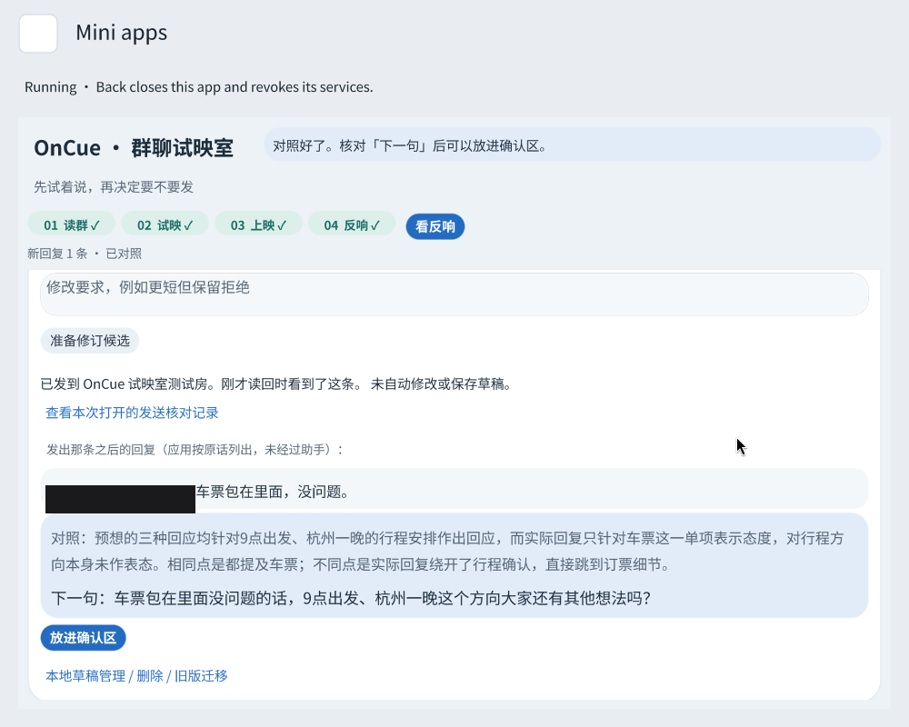</td>
    <td>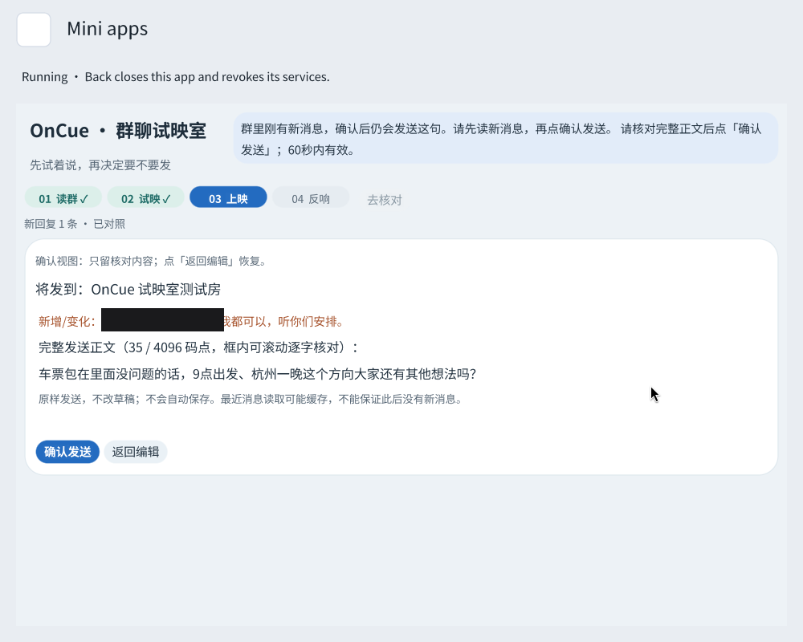</td>
  </tr>
  <tr>
    <td align="center"><sub>确认：发到哪个群、完整正文</sub></td>
    <td align="center"><sub>反响：原话照列，对照给出下一句</sub></td>
    <td align="center"><sub>复核：确认前来了新消息，先标出</sub></td>
  </tr>
</table>

<p align="center">
  <a href="https://www.bilibili.com/video/BV18aWA6HECb">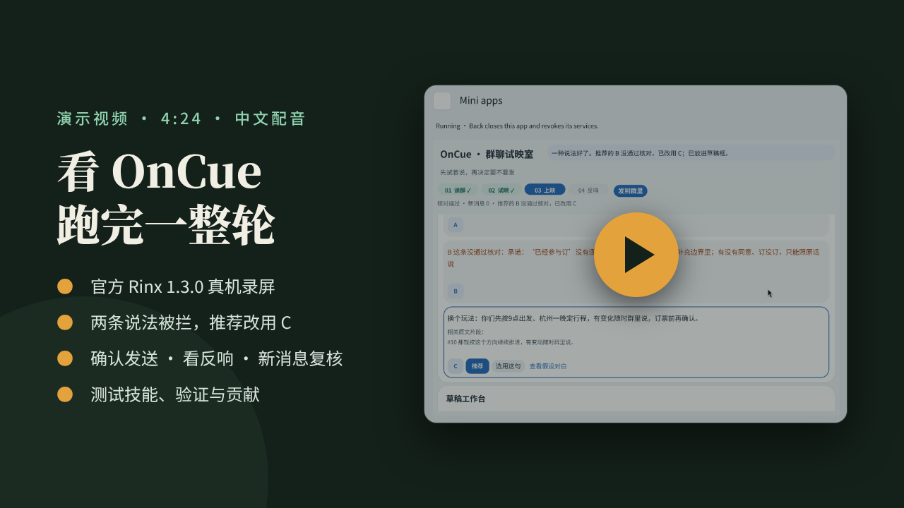</a>
  <br><sub>点击在 B 站观看带配音的演示（1:56）· <a href="evidence/demo/oncue-demo-053-2min.mp4">仓库内同一视频</a> · <a href="evidence/demo/oncue-demo-053.mp4">含 PPT 讲解的完整版（4:24）</a></sub>
</p>

## 测试

每改一次代码，全部测试重跑。

| 测试 | 结果 | 说明 |
| --- | --- | --- |
| 界面场景 | 85/85 次运行通过 | 75 个场景共 85 次运行，覆盖 412×892、954×448、1000×800 三种尺寸，宿主的每种回复和错误由场景注入 |
| 逻辑测试 | 12 套 437 项断言通过 | 在真实 card-host 虚拟机里直接跑生产函数，结果[可离线复核](evidence/logic-tests/) |
| 工具单元测试 | 114 项通过 | `oncue/tools` 的单元测试 |
| 打包检查 | `hub check` 通过 | 只有「未签名」提示 |
| 真机闭环 | 官方 Rinx 1.3.0 跑通 | 读群 → 试映 → 确认发送 → 读回 → 看反响 → 新消息复核，[证据](evidence/native-130/) |
| 授权状态 | 4 种实拍 | 未选房间、未允许、撤回、到期，[证据](evidence/auth-053/) |

```bash
# 工具单元测试：不需要宿主和网络
python3 -m unittest discover -s oncue/tests -p 'selftest_*.py' -v

# 界面场景：用 splash-app-verify 在 card-host 里跑真应用
python3 skills/splash-app-verify/scripts/uitest.py run bundle oncue/tests/ui --keep-going
```

逻辑测试需要先构建 `hub` 和 `card-host`，步骤见[测试说明](oncue/tests/README.md)。为适配 Rinx 1.3.0 单次回调 20 万条指令的上限，核对拆进计时器回调分步执行；等待助手的期限为 150 秒。

## 项目结构

```text
bundle/                     应用包（main.splash、manifest、字体与图标）
oncue/
  BRIEF.md                  产品说明
  PRIVACY.md                数据说明
  VERIFICATION.md           验证记录
  docs/RUNNING.md           运行说明
  tests/                    界面场景与逻辑测试
  tools/                    打包、印章与证据工具
skills/splash-app-verify/   测试技能（已向 App Flow 提交 PR #192）
evidence/                   真机截图、测试结果与演示视频
build/                      审核问答与宿主问题复现材料
```

## 对 OctoSense 的贡献

**splash-app-verify 测试技能**，已向 OctoSense App Flow 提交 [PR #192](https://github.com/OctoSense-org/OctoSense-App-Flow/pull/192)（[仓库内副本](skills/splash-app-verify/)）。

开发 Splash 应用时，card-host 里没有真实的宿主服务，授权过期、限流、发送超时这些情况都造不出来。这个技能的做法是：先写界面契约和场景，再写代码；假宿主按场景回复，每次修改全量重跑，失败时给出修复清单。它在 OnCue 交付前抓到了 5 个真问题，任何 Splash 应用都能用。Splash 空态语法的文档随同一个 PR 提交。

<details>
<summary><b>回应初赛评审的建议</b></summary>
<br>
<table>
  <tr><th>建议</th><th>做了什么</th></tr>
  <tr><td>补「拒绝授权、授权到期」的验证记录</td><td>在官方 Rinx 上实拍四种授权状态；授权到期实测约 1 小时</td></tr>
  <tr><td>防编造扩展到中文数字和承诺句式</td><td>覆盖带单位的中文数字、半天、复合单位；承诺句式逐句检查</td></tr>
  <tr><td>应用包移到仓库根目录</td><td>已移到 <code>bundle/</code></td></tr>
  <tr><td>改用 GitHub 发布流程</td><td>打 tag 触发 <code>publish-app.yml</code>，当前版本 0.5.4</td></tr>
</table>
</details>

## 文档

[产品说明](oncue/BRIEF.md) · [数据说明](oncue/PRIVACY.md) · [运行说明](oncue/docs/RUNNING.md) · [验证记录](oncue/VERIFICATION.md) · [测试说明](oncue/tests/README.md) · [更新记录](CHANGELOG.md) · [审核问答](build/REVIEW-ANSWERS.md)

## 许可证

[Apache License 2.0](LICENSE) · GOSIM 智能体应用黑客松 2026 复赛作品
